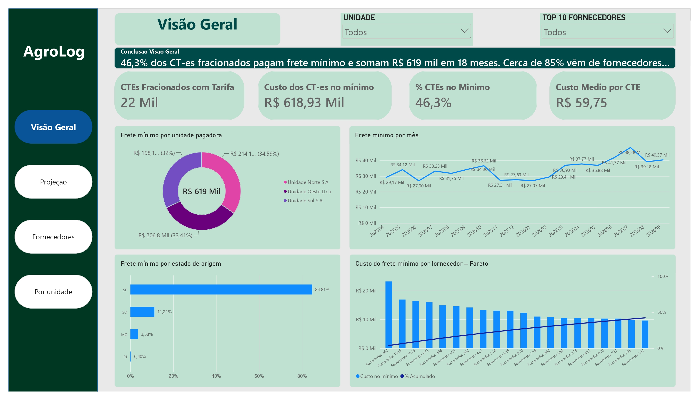
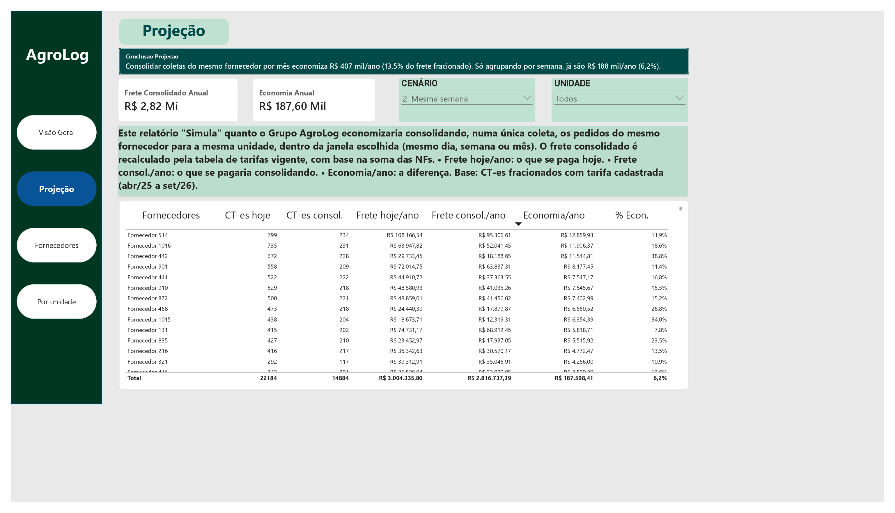
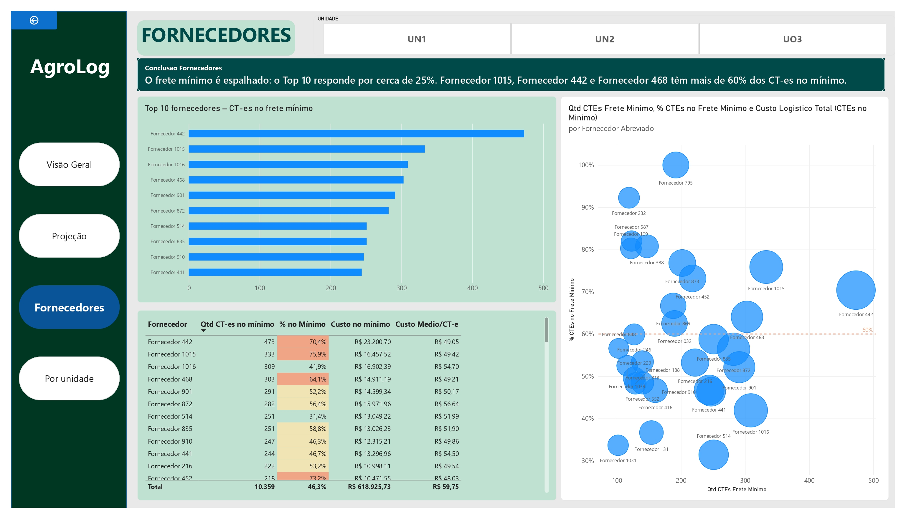
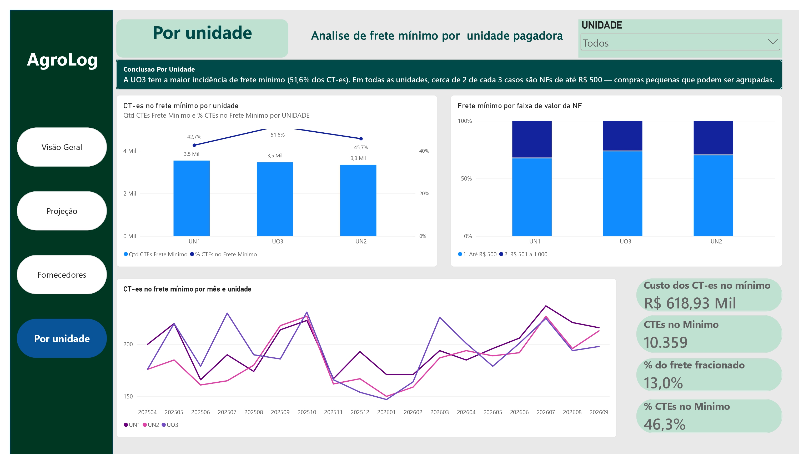

# 📊 Análise de Frete Mínimo e Simulação de Consolidação de Cargas

> *Nota: Os nomes das empresas, fornecedores e valores financeiros foram anonimizados para fins de demonstração em portfólio, mantendo as proporções e regras de negócio originais.*

## 🎯 Problema de Negócio
Alta incidência de cobrança de tarifa mínima em embarques fracionados entre três unidades operacionais (`UN1`, `UN2` e `UO3`), impulsionada por pedidos fragmentados de baixo valor (NFs de até R$ 500). O cenário representava **46,3% dos CT-es fracionados** e um custo acumulado de **R$ 619 mil** em 18 meses.

## 🛠️ Solução Desenvolvida (Ação)
Construção de um dashboard executivo e analítico em **Power BI** utilizando modelagem dimensional (*Star Schema*), tratamento de dados via **Power Query (M)** e cálculos avançados em **DAX**:
* **Visão Geral:** Diagnóstico de incidência de frete mínimo, evolução mensal e concentração geográfica (85% concentrados em fornecedores de SP).
* **Simulador de Projeção:** Cálculo dinâmico de economia ao consolidar coletas do mesmo fornecedor para a mesma unidade em janelas diárias, semanais ou mensais.
* **Análise de Fornecedores (Pareto & Dispersão):** Cruzamento de volume de CT-es x percentual de incidência no mínimo para priorização de renegociação contratual.
* **Análise por Unidade:** Comparativo de incidência por planta e estratificação por faixa de valor da Nota Fiscal.

## 📈 Principais Resultados
* Identificação de que **2 a cada 3 ocorrências** de frete mínimo são originadas por NFs de até R$ 500.
* A consolidação mensal de coletas por fornecedor/unidade projeta uma economia de **R$ 407 mil/ano** (**13,5%** de redução no frete fracionado).
* Mesmo no cenário conservador (agrupamento semanal), a economia estimada atinge **R$ 188 mil/ano (6,2%)**.

---

## 💻 Engenharia de Dados, DAX e Power Query (M)

### 1. Tratamento e Padronização de Fornecedores (Power Query / M)
Remoção de sufixos jurídicos (LTDA, S/A, EIRELI) e tratamento de homônimos adicionando o município para evitar duplicidades nos gráficos:

```powerquery
Limpo = Table.AddColumn(#"Tipo de coluna alterado", "NomeLimpo", each
    let
        t = " " & Text.Upper([FORNECEDOR]) & " ",
        lixo = {" LTDA."," LTDA"," S/A"," S.A."," EIRELI"," UNIPESSOAL"," ME "," EPP ",
                " COMERCIO DE "," COMERCIO "," COM E "," IND E "," INDUSTRIA E "," DISTRIBUIDORA "},
        r = List.Accumulate(lixo, t, (s, x) => Text.Replace(s, x, " "))
    in
        Text.Start(Text.Trim(Text.Combine(List.Select(Text.Split(r, " "), each _ <> ""), " ")), 25),
    type text),

Contagem = Table.Group(Limpo, {"NomeLimpo"}, {{"Qtd", each List.Count(List.Distinct([FORNECEDOR])), Int64.Type}}),
Junta = Table.NestedJoin(Limpo, {"NomeLimpo"}, Contagem, {"NomeLimpo"}, "C", JoinKind.LeftOuter),
Expande = Table.ExpandTableColumn(Junta, "C", {"Qtd"}),
Final = Table.AddColumn(Expande, "Fornecedor Abreviado", each
    if [Qtd] > 1 then [NomeLimpo] & " - " & [MUNICIPIO] else [NomeLimpo], type text)
```

### 2. Principais Medidas Analíticas (DAX)
Exemplos de medidas desenvolvidas para diagnóstico de incidência, custo médio e participação no frete fracionado:

```dax
// Quantidade de CT-es cobrados na tarifa mínima
Qtd CTEs Frete Minimo = 
CALCULATE(
    DISTINCTCOUNT(fato_cte[CTEID]),
    fato_cte[CLASSIFICACAO] = "Frete Mínimo"
)

// Percentual de incidência de frete mínimo sobre o total fracionado
% CTEs no Minimo = 
DIVIDE(
    [Qtd CTEs Frete Minimo],
    DISTINCTCOUNT(fato_cte[CTEID]),
    0
)

// Custo total dos CT-es no mínimo
Custo Logistico Total (CTEs no Minimo) = 
CALCULATE(
    SUM(fato_cte[TOTAL_FRETE]),
    fato_cte[CLASSIFICACAO] = "Frete Mínimo"
)

// Custo médio por conhecimento de transporte no mínimo
Custo Medio por CTE = 
DIVIDE(
    [Custo Logistico Total (CTEs no Minimo)],
    [Qtd CTEs Frete Minimo],
    0
)
```

---

## 🖼️ Páginas do Relatório

### 1. Visão Geral


### 2. Simulação e Projeção


### 3. Análise de Fornecedores


### 4. Análise por Unidade

